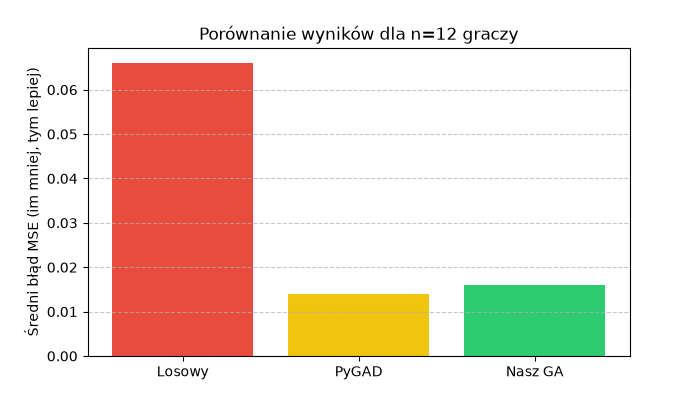
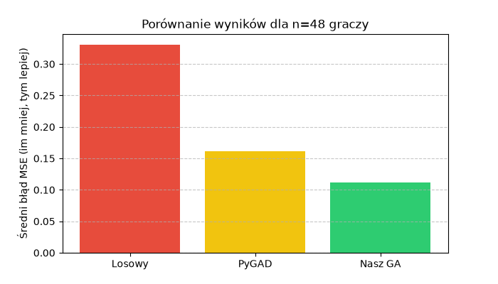

# <Tytuł projektu>

**Zespół:** Z9 · grupa L2 · **Repozytorium:** "https://github.com/mpaduch2-lab/Turniej-Bocce"
Sztuczna inteligencja — laboratorium · Collegium Da Vinci · rok akad. 2026/2027

## 1. Problem *(rubryka A)*

> Co tu wpisać: kto ma problem, w jakiej sytuacji, co system dla niego robi. Co wchodzi do systemu, co z niego wychodzi. 3–6 zdań, rozwinięcie pkt 4 karty tematu.

## 2. Dlaczego SI i dlaczego ta technika *(B · 7 pkt)*

> Co tu wpisać: dlaczego zwykły algorytm nie wystarcza (nie umiemy zapisać reguły / przepis jest za drogi / reguł jest za dużo). Dlaczego wybraliście tę technikę z modułu, a nie inną — jedno zdanie o tym, co by się stało przy alternatywie.

## 3. Dane *(B · 8 pkt)*

Dane generowane są przy pomocy skrytpu generator.py. Generuje on po 3 niezależne zestawy danych (seed 1, 2, 3) w różnych wielkościach (12, 24, i 48 wierszy). Dane składają się z ośmiu kolumn - jednej teksotwej (przykładowe Imię i nazwisko) oraz 7 liczbowych (Celność, Panowanie nad stresem, Poziom koncentracji, Siła rzutu, Skuteczność rzutów, Dostosowywanie się do terenu, Umiejętność czytania gry) które są znormalizowane (z przedziału $[0, 1]$) i generowane na podstawie rozkładu normalnego $\mathcal{N}(0.5, 0.1)$.

## 4. Rozwiązanie *(A · 10 pkt, B · 5 pkt)*

> Co tu wpisać:
> - schemat działania systemu (lista kroków albo diagram),
> - opis algorytmu SI z jego podstawą matematyczną: wzór lub pojęcie z zajęć (np. funkcja oceny, gradient, entropia) i co oznacza w Waszym problemie,
> - kluczowe parametry i ich wartości (np. rozmiar populacji, liczba epok, głębokość drzewa).

## 5. Ewaluacja *(B · 8 pkt)*

**Metryka:** Funkcja zrównoważenia drużyn oparta na średnim błędzie kwadratowym (MSE), mierząca odchylenie średnich statystyk poszczególnych drużyn od średniej wszystkich graczy w turnieju.

**Punkt odniesienia:** Metoda bazowa polegająca na 1000 losowych prób podziału zawodników na 3-osobowe drużyny.

#### Tabela z wynikami eksperymentu (Średnia wartość MSE):

| Przypadek / Zbiór | Punkt odniesienia (Losowy) | Biblioteka PyGAD | Nasz Algorytm Genetyczny |
| :--- | :--- | :--- | :--- |
| **12 graczy** | 0.06611 | 0.01410 | *(uzupełni Mateusz)* |
| **24 graczy** | 0.15129 | 0.05062 | *(uzupełni Mateusz)* |
| **48 graczy** | 0.33194 | 0.16160 | *(uzupełni Mateusz)* |

*Uwaga: Wartości w tabeli stanowią uśredniony błąd MSE wyznaczony z 3 niezależnych zestawów danych (v1, v2, v3).*

#### Wykresy porównawcze:





#### Wnioski z przeprowadzonej analizy:
1. **Wyraźna przewaga optymalizacji:** Zastosowanie algorytmu genetycznego z biblioteki PyGAD pozwoliło na wielokrotne obniżenie błędu zrównoważenia drużyn (MSE) w porównaniu do losowego podziału zawodników we wszystkich przetestowanych wariantach.
2. **Skalowalność rozwiązania:** Dla standardowego turnieju (n = 48 graczy) przestrzeń możliwych podziałów jest astronomicznie duża. Metoda losowa uzyskuje bardzo wysoki błąd (MSE ≈ 0.33), podczas gdy PyGAD redukuje go ponad dwukrotnie (MSE ≈ 0.16), co dowodzi praktycznej skuteczności algorytmu genetycznego w rozwiązywaniu tego problemu.
## 6. Wymagania niefunkcjonalne *(A · 5 pkt)*

## 6. Wymagania niefunkcjonalne

* **Czas działania i środowisko pomiarowe:**
  * Pomiary wykonano na komputerze z systemem Windows w środowisku **Python 3.11** z wykorzystaniem biblioteki **NumPy**.
  * Parametry uruchomienia algorytmu: wielkość populacji `POPULATION_SIZE = 40`, liczba pokoleń `GENERATIONS = 100`, współczynnik mutacji `MUTATION_RATE = 0.15`.
  * Pełna ewaluacja obejmująca **270 uruchomień** (zestawy po 12, 24 i 48 graczy × 3 warianty plików × 30 powtórzeń) trwa około **15–25 sekund** (pojedyncze wywołanie algorytmu wykonuje się w ułamku sekundy).
  * **Wyniki ewaluacji (średnia wartość funkcji przystosowania `fitness` – im bliżej `0`, tym bardziej wyrównane są drużyny):**
    * **12 graczy (4 drużyny):** `0.01115`
    * **24 graczy (8 drużyn):** `0.01121`
    * **48 graczy (16 drużyn):** `0.01151`
    * Wniosek: Algorytm utrzymuje bardzo wysoką i stabilną jakość wyrównania składów nawet przy 4-krotnym zwiększeniu liczby zawodników.
* **Obsługa złych lub brakujących danych:**
  * Brak pliku CSV lub błąd w jego nazwie powoduje zatrzymanie programu wyjątkiem `FileNotFoundError` (brak obsługi błędów `try-except`).
  * Jeśli liczba graczy nie dzieli się przez 3, operacja dzielenia całkowitego (`TEAM_AMOUNT = NUM_PLAYERS // 3`) ucina nadmiarowe osoby, które nie zostają przydzielone do żadnej drużyny.
  * W przypadku pustych komórek lub wartości tekstowych w kolumnach ze statystykami funkcja `astype(np.float64)` zwraca wartość `NaN` (zaburzającą obliczanie `fitness`) lub przerywa działanie błędem `ValueError`.
* **Powtarzalność wyników (ziarno losowości):**
  * Pojedyncze uruchomienia **nie są powtarzalne**, ponieważ w kodzie nie ustawiono ziarna losowości (`random.seed()` ani `np.random.seed()`). Z tego powodu w ewaluacji uśredniono wyniki z 30 niezależnych uruchomień dla każdego zbioru.

## 7. Ograniczenia

* **Kiedy system się myli lub nie zadziała (konkretne przykłady):**
  1. **Liczba zawodników niepodzielna przez 3:** Przy 13 lub 14 graczach w pliku CSV algorytm utworzy 4 pełne drużyny (12 osób), a pozostałe 1–2 osoby pominie bez żadnego ostrzeżenia.
  2. **Równe wagi wszystkich cech (`WEIGHTS = np.ones(...)`):** Każda statystyka gracza ma taką samą wagę `1.0`. W realnym turnieju celność rzutów może być ważniejsza niż inne parametry – brak zróżnicowania wag może sprawić, że drużyny będą równe według średniej, ale jedna z nich zdominuje turniej dzięki jednej kluczowej umiejętności.
  3. **Naprawa duplikatów podczas krzyżowania (`crossover`):** Jeśli w jednym osobniku po krzyżowaniu powtórzy się więcej niż jeden gracz, aktualna naprawa przypisuje brakujący numer do wszystkich indeksów duplikatów jednocześnie (`child1[duplicates[0]] = value`), co może wymagać dodatkowej walidacji poprawności składu.
* **Co zrobilibyśmy dalej, mając więcej czasu:**
  * Dodanie opcjonalnego ustawiania ziarna losowości (`seed`) dla pełnej powtarzalności testów.
  * Dodanie walidacji danych wejściowych oraz obsługi niepełnych składów (np. tworzenie drużyn 2-osobowych lub listy rezerwowych przy liczbie graczy niepodzielnej przez 3).
  * Umożliwienie zmiany wag statystyk oraz parametrów algorytmu bez edycji kodu źródłowego.
  * Dodanie zapisu wylosowanych drużyn do pliku wynikowego (CSV/PDF) oraz wykresu spadku błędu `fitness` w kolejnych pokoleniach.
* **Aktualność zastosowanej technologii:**
  * **Python**, **NumPy** oraz **algorytmy genetyczne** są nadal powszechnie stosowane w problemach kombinatorycznych (gdzie liczba możliwych kombinacji rośnie zbyt szybko, by sprawdzić wszystkie). W dużych systemach produkcyjnych obok klasycznych algorytmów genetycznych stosuje się dziś również wyspecjalizowane solvery optymalizacyjne (np. **Google OR-Tools**) oraz metody oparte na uczeniu ze wzmocnieniem (Reinforcement Learning).

## 8. Zastosowania w praktyce

* **Gdzie podobne rozwiązania są używane w branży:**
  * **Gry wideo i e-sport (Systemy Matchmakingu):** Algorytmy równoważące składy drużyn na podstawie wielu statystyk graczy (ranking MMR, historia wygranych, role) działają m.in. w *League of Legends* (Riot Games), *Counter-Strike 2* (Valve) oraz *Rocket League*.
  * **Sport amatorski i organizacja turniejów:** Organizatorzy rozgrywek ligowych i turniejów (bocce, siatkówka, piłka nożna halowa) używają podobnych algorytmów do losowania wyrównanych drużyn i grup na podstawie statystyk zawodników.
  * **Zarządzanie zespołami i edukacja:** Tworzenie zbalansowanych zespołów projektowych w firmach IT (łączenie osób o różnych kompetencjach) lub podział studentów na grupy laboratoryjne o zbliżonym poziomie.

## 9. Zespół

| Osoba | Za co odpowiadała |
| :--- | :--- |
| **Mateusz** | Przygotowanie generatora danych (`generator.py`) oraz zestawów testowych CSV (12, 24, 48 graczy), implementacja algorytmu genetycznego (`implementation_genetic_algorithm.py`), uzupełnienie sekcji 1–2 dokumentacji oraz `README.md`. |
| **Antonina Bentyn** | Uruchomienie i ewaluacja algorytmu na wszystkich zestawach danych (12, 24 i 48 graczy – 270 uruchomień), analiza wydajności, powtarzalności i przypadków brzegowych, opracowanie sekcji 6, 7 i 8 dokumentacji (`dokumentacja.md`). |

## 10. Uruchomienie *(C · 4 pkt)*

> Co tu wpisać: kroki od sklonowania repozytorium do wyniku, tak żeby obca osoba dała radę bez pytania autorów: wymagania, instalacja, polecenie uruchomienia, gdzie pojawi się wynik.

```
git clone <repozytorium>
cd <katalog>
pip install -r requirements.txt
python <plik>.py
```

## 11. Narzędzia AI

> Co tu wpisać: czy korzystaliście z narzędzi AI (np. ChatGPT, Claude, Copilot) i do czego — kod, tekst, debugowanie. Jeśli nie — napiszcie „nie korzystaliśmy”. Pamiętajcie: każdą linię kodu musicie umieć wyjaśnić na obronie.
