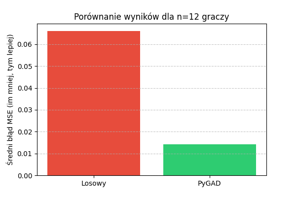
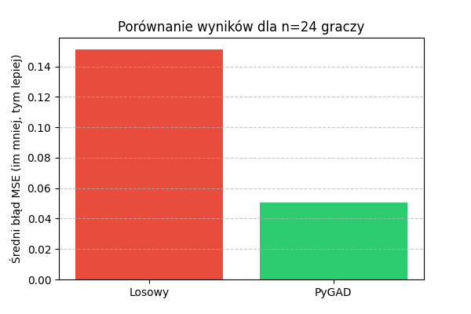
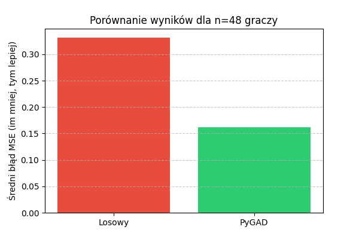

# <Tytuł projektu>

**Zespół:** Z9 · grupa L2 · **Repozytorium:** "https://github.com/mpaduch2-lab/Turniej-Bocce"
Sztuczna inteligencja — laboratorium · Collegium Da Vinci · rok akad. 2026/2027

## 1. Problem *(rubryka A)*

> Co tu wpisać: kto ma problem, w jakiej sytuacji, co system dla niego robi. Co wchodzi do systemu, co z niego wychodzi. 3–6 zdań, rozwinięcie pkt 4 karty tematu.

## 2. Dlaczego SI i dlaczego ta technika *(B · 7 pkt)*

> Co tu wpisać: dlaczego zwykły algorytm nie wystarcza (nie umiemy zapisać reguły / przepis jest za drogi / reguł jest za dużo). Dlaczego wybraliście tę technikę z modułu, a nie inną — jedno zdanie o tym, co by się stało przy alternatywie.

## 3. Dane *(B · 8 pkt)*

Dane generowane są przy pomocy skrytpu generator.py. Generuje on po 3 niezależne zestawy danych (seed 1, 2, 3) w różnych wielkościach (12, 24, i 48 wierszy). Dane składają się z ośmiu kolumn - jednej teksotwej (przykładowe Imię i nazwisko) oraz 7 liczbowych (Celność, Panowanie nad stresem, Poziom koncentracji, Siła rzutu, Skuteczność rzutów, Dostosowywanie się do terenu, Umiejętność czytania gry) które są znormalizowane (z przedziału $[0, 1]$) i generowane na podstawie rozkładu normalnego $\mathcal{N}(0.5, 0.1)$.

## 4. Rozwiązanie *(A · 10 pkt, B · 5 pkt)*

> Co tu wpisać:
> - schemat działania systemu (lista kroków albo diagram),
> - opis algorytmu SI z jego podstawą matematyczną: wzór lub pojęcie z zajęć (np. funkcja oceny, gradient, entropia) i co oznacza w Waszym problemie,
> - kluczowe parametry i ich wartości (np. rozmiar populacji, liczba epok, głębokość drzewa).

## 5. Ewaluacja *(B · 8 pkt)*

**Metryka:** Funkcja zrównoważenia drużyn oparta na średnim błędzie kwadratowym (MSE), mierząca odchylenie średnich statystyk poszczególnych drużyn od średniej wszystkich graczy w turnieju.

**Punkt odniesienia:** Metoda bazowa polegająca na 1000 losowych prób podziału zawodników na 3-osobowe drużyny.

#### Tabela z wynikami eksperymentu (Średnia wartość MSE):

| Przypadek / Zbiór | Punkt odniesienia (Losowy) | Biblioteka PyGAD | Nasz Algorytm Genetyczny |
| :--- | :--- | :--- | :--- |
| **12 graczy** | 0.06611 | 0.01410 | *(uzupełni Mateusz)* |
| **24 graczy** | 0.15129 | 0.05062 | *(uzupełni Mateusz)* |
| **48 graczy** | 0.33194 | 0.16160 | *(uzupełni Mateusz)* |

*Uwaga: Wartości w tabeli stanowią uśredniony błąd MSE wyznaczony z 3 niezależnych zestawów danych (v1, v2, v3).*

#### Wykresy porównawcze:





#### Wnioski z przeprowadzonej analizy:
1. **Wyraźna przewaga optymalizacji:** Zastosowanie algorytmu genetycznego z biblioteki PyGAD pozwoliło na wielokrotne obniżenie błędu zrównoważenia drużyn (MSE) w porównaniu do losowego podziału zawodników we wszystkich przetestowanych wariantach.
2. **Skalowalność rozwiązania:** Dla standardowego turnieju (n = 48 graczy) przestrzeń możliwych podziałów jest astronomicznie duża. Metoda losowa uzyskuje bardzo wysoki błąd (MSE ≈ 0.33), podczas gdy PyGAD redukuje go ponad dwukrotnie (MSE ≈ 0.16), co dowodzi praktycznej skuteczności algorytmu genetycznego w rozwiązywaniu tego problemu.

## 6. Wymagania niefunkcjonalne *(A · 5 pkt)*

> Co tu wpisać: ile trwa działanie (na czym mierzone), co się dzieje przy złych lub brakujących danych, czy wyniki są powtarzalne (ziarno losowości).

## 7. Ograniczenia *(E · 4 pkt)*

> Co tu wpisać: kiedy system się myli albo nie zadziała — najlepiej na konkretnym przykładzie. Co zrobilibyście dalej, mając więcej czasu. Czy zastosowana technologia jest dziś nadal stosowana, czy zastąpiły ją nowsze.

## 8. Zastosowania w praktyce *(E · 4 pkt)*

> Co tu wpisać: gdzie podobne rozwiązania są używane w branży (firma, produkt, dziedzina). Jeśli rozmawialiście z praktykiem — co powiedział i co zmieniliście.

## 9. Zespół *(D · 8 pkt)*

> Co tu wpisać: kto za co odpowiadał. Jeśli role się zmieniały — napiszcie kiedy i dlaczego. Wkład powinien zgadzać się z historią repozytorium.

| Osoba | Za co odpowiadała |
|---|---|
| … | … |

## 10. Uruchomienie *(C · 4 pkt)*

> Co tu wpisać: kroki od sklonowania repozytorium do wyniku, tak żeby obca osoba dała radę bez pytania autorów: wymagania, instalacja, polecenie uruchomienia, gdzie pojawi się wynik.

```
git clone <repozytorium>
cd <katalog>
pip install -r requirements.txt
python <plik>.py
```

## 11. Narzędzia AI

> Co tu wpisać: czy korzystaliście z narzędzi AI (np. ChatGPT, Claude, Copilot) i do czego — kod, tekst, debugowanie. Jeśli nie — napiszcie „nie korzystaliśmy”. Pamiętajcie: każdą linię kodu musicie umieć wyjaśnić na obronie.
