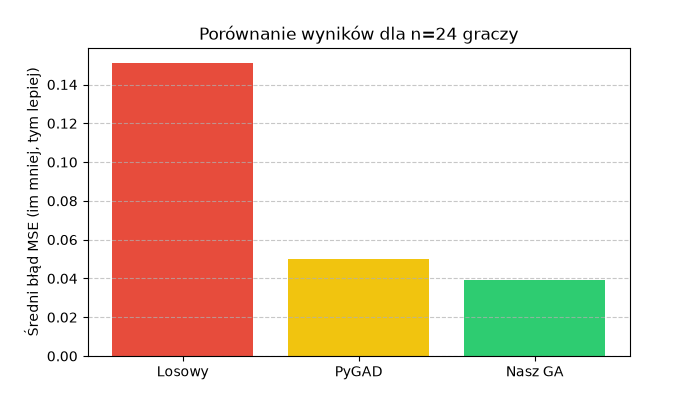

# Turniej Bocce

**Zespół:** Z9 · grupa L2 · **Repozytorium:** "https://github.com/mpaduch2-lab/Turniej-Bocce"
Sztuczna inteligencja — laboratorium · Collegium Da Vinci · rok akad. 2026/2027

## 1. Problem *(rubryka A)*

System będzie przeznaczony dla organizatorów/organizatorek turniejów. Dla zachowania największego napięcia wśród oglądających oraz zapewnienie poczucia sprawiedliwości i równego traktowania wszystkich, drużyny biorące udział w turnieju nie powinny znacząco odbiegać od siebie poziomem umiejętności, co jest trudne do zrobienia. System zwraca podział zawodników na drużyny z zachowaniem jak najmniejszej różnicy statystyk między drużynami.

Do systemu wchodzą znormalizowane statystyki graczy (liczba graczy - wierszy musi być podzielna przez 3) wraz z ich imieniem i nazwiskiem w postaci pliku o rozszerzeniu .csv. Z systemu wychodzi lista indeksów oznaczających kolejność zawodników z których kolejne trójki składają się na jedną drużynę. Otrzymane drużyny mają zbliżone do siebie średnie statystyki.

## 2. Dlaczego SI i dlaczego ta technika *(B · 7 pkt)*

Zwykły algorytm nie pasuje do problemu gdyż ma on zbyt wiele parametrów i możliwości - **przepis jest za drogi**. Algorytm zwykły zająłby zbyt dużo czasu dla dużej liczby uczestników. Ilość kombinacji do sprawdzenia dla n zawodników (podzielonych na drużyny trzyosobowe) wyraża się wzorem:

$$
T(n) = \frac{n!} {(3!)^{\frac{n} {3}}(\frac{n}{3})!}
$$

n musi być liczbą podzielną przez 3. $n!$ oznacza liczbę możliwych ustawień wszystkich osób. $(3!)^{\frac{n} {3}}$ oznacza brak zależności kolejności w każdej z $\frac n 3$ drużyn. $(\frac{n}{3})!$ oznacza brak znaczenia kolejności drużyn.

| $n$ podzielne przez $3$ | $T(n)$ |
| --- | --- |
| $12$ | $15400$  |
| $24$ | $\approx 1.18 \times10^{18}$  |
| $48$ - standardowa ilość osób w turnieju | $\approx 1.23 \times10^{38}$  |

Sprawdzając 1 miliard podziałów na sekundę sprawdzenie wszystkich podziałów dla 48 osób zajęłoby $3.9 \times 10^{21}$ lat, czyli więcej niż wiek Wszechświata.

Algorytmy genetyczne bardzo szybko przeszukują duże przestrzenie rozwiązań i pozwalają znaleźć optymalny lub bliski optymalnemu podział w problemach kombinatorycznych, gdzie sprawdzenie wszystkich kombinacji jest niemożliwe obliczeniowo. 

W tym przypadku pojedynczym osobnikiem (chromosomem) jest permutacja liczb od $1$ do $N$ (np. od $1$ do $48$ dla maksymalnego zbioru danych), gdzie każda liczba stanowi unikalny identyfikator gracza. Kolejne trójki elementów w tym ciągu tworzą bezpośrednio składy kolejnych drużyn (od $1$ do $\frac{N}{3}$, czyli dla $48$ graczy otrzymujemy $16$ zespołów).

Aby zapewnić poprawność podziału, funkcja przystosowania (*fitness*) odrzuca nieprawidłowe rozwiązania, przypisując wartość $\infin$ tym ciągom, w których jakikolwiek zawodnik powtarza się w obrębie jednego osobnika. Dla poprawnych permutacji funkcja dąży do minimalizacji nierównowagi między zespołami i oblicza sumę ważonych kwadratów odchyleń średnich statystyk każdej drużyny od średniej globalnej wszystkich zawodników:

$$
\sum_{i=1}^{N/3} \sum_{j=1}^{7} w_j \left( \frac{1}{3} \left( S[x_{3i-2}, j] + S[x_{3i-1}, j] + S[x_{3i}, j] \right) - \mu_j \right)^2
$$

gdzie:
* $N$ – całkowita liczba graczy (odpowiadająca liczbie genów w chromosomie),
* $i$ – indeks drużyny ($i \in \{1, \dots, \frac{N}{3}\}$),
* $j$ – indeks badanej statystyki gracza ($j \in \{1, \dots, 7\}$),
* $x_k$ – identyfikator gracza na $k$-tej pozycji w chromosomie,
* $S[x, j]$ – wartość $j$-tej statystyki dla gracza o identyfikatorze $x$,
* $\mu_j$ – średnia wartość $j$-tej statystyki wyliczona dla wszystkich graczy biorących udział w turnieju,
* $w_j$ – waga przypisana do $j$-tej statystyki.

Wybraliśmy algorytm genetyczny zamiast przeglądu wszystkich możliwości (brute-force), ponieważ ten drugi przy 48 graczach załamałby się obliczeniowo ze względu na astronomiczną liczbę możliwych kombinacji podziału na drużyny.

Nie wykorzystaliśmy sieci neuronowej, gdyż sieć neuronowa wymagałaby posiadania obszernego zbioru danych treningowych oraz skomplikowanej architektury (np. uczenia ze wzmocnieniem), podczas gdy podział graczy na zbalansowane drużyny to czysta optymalizacja kombinatoryczna, którą algorytm genetyczny rozwiązuje bezpośrednio i efektywnie bez potrzeby kosztownej fazy treningowej.

## 3. Dane *(B · 8 pkt)*

Dane generowane są przy pomocy skrytpu generator.py. Generuje on po 3 niezależne zestawy danych (seed 1, 2, 3) w różnych wielkościach (12, 24, i 48 wierszy). Dane składają się z ośmiu kolumn - jednej teksotwej (przykładowe Imię i nazwisko) oraz 7 liczbowych (Celność, Panowanie nad stresem, Poziom koncentracji, Siła rzutu, Skuteczność rzutów, Dostosowywanie się do terenu, Umiejętność czytania gry) które są znormalizowane (z przedziału $[0, 1]$) i generowane na podstawie rozkładu normalnego $\mathcal{N}(0.5, 0.1)$.

## 4. Rozwiązanie *(A · 10 pkt, B · 5 pkt)*

### 1. Schemat działania systemu

System służy do automatycznego podziału graczy w Bocce na trzyosobowe drużyny w taki sposób, aby poziom umiejętności poszczególnych zespołów był jak najbardziej wyrównany. Do rozwiązania problemu wykorzystaliśmy algorytm genetyczny, który przeszukuje możliwe kombinacje podziału zawodników i wybiera te, które zapewniają najlepsze zbalansowanie drużyn.

Działanie systemu przebiega w następujących krokach:

1. **Wczytanie danych** – system odczytuje z pliku CSV listę zawodników oraz przypisane im statystyki.
2. **Inicjalizacja populacji** – generowana jest początkowa populacja składająca się z 40 losowych osobników. Każdy osobnik reprezentuje jeden możliwy podział zawodników na drużyny.
3. **Ocena przystosowania** – dla każdego osobnika obliczana jest wartość funkcji przystosowania (fitness), która określa, jak bardzo drużyny różnią się poziomem od ogólnej średniej wszystkich zawodników.
4. **Selekcja rodziców** – osobniki o najlepszych wartościach funkcji przystosowania są wybierane do dalszego rozmnażania.
5. **Krzyżowanie** – wybrani rodzice łączeni są za pomocą krzyżowania jednopunktowego. Następnie usuwane są ewentualne powtórzenia zawodników.
6. **Mutacja** – z prawdopodobieństwem 15% następuje zamiana miejscami dwóch losowo wybranych zawodników w chromosomie.
7. **Selekcja nowej populacji** – spośród dotychczasowych osobników oraz nowo utworzonych potomków wybierane są najlepsze rozwiązania, które tworzą kolejną populację.
8. **Powtarzanie procesu** – kroki od 3 do 7 wykonywane są przez 100 pokoleń.
9. **Zwrócenie wyniku** – system zwraca najlepszy znaleziony podział zawodników na drużyny oraz wartość jego funkcji przystosowania.

### 2. Opis algorytmu SI i podstawa matematyczna

W projekcie zastosowaliśmy algorytm genetyczny. Algorytm wykorzystuje mechanizmy selekcji naturalnej, krzyżowania oraz mutacji, aby stopniowo poprawiać jakość uzyskiwanych rozwiązań.

W naszym problemie pojedynczy osobnik reprezentuje jeden możliwy podział wszystkich zawodników na trzyosobowe drużyny. Chromosom ma postać permutacji numerów zawodników, np.:

`[3, 7, 1 | 5, 2, 8 | 4, 6, 9]`

Oznacza to, że:
- pierwsza drużyna składa się z graczy 3, 7 i 1,
- druga drużyna składa się z graczy 5, 2 i 8,
- trzecia drużyna składa się z graczy 4, 6 i 9.

Każdy zawodnik występuje dokładnie raz, dzięki czemu nie dochodzi do przypisania tej samej osoby do kilku drużyn.

#### Funkcja przystosowania (fitness)

Najważniejszym elementem algorytmu jest funkcja przystosowania, która ocenia jakość danego podziału. W projekcie wykorzystano sumę kwadratów różnic pomiędzy średnimi wartościami statystyk drużyn a średnimi wartościami tych statystyk dla wszystkich zawodników.

Funkcję można zapisać wzorem:

$$
F(X)=\sum_{j=1}^{S}\sum_{i=1}^{T}
w_j\left(\overline{x}_{ij}-\mu_j\right)^2
$$

Gdzie:
- $F(X)$ – wartość funkcji przystosowania dla danego podziału,
- $S$ – liczba analizowanych statystyk,
- $T$ – liczba utworzonych drużyn,
- $w_j$ – waga przypisana danej statystyce,
- **$\overline{x}_{ij}$ – średnia wartość statystyki $j$ w drużynie $i$**,
- $\mu_j$ – średnia wartość statystyki $j$ dla wszystkich zawodników.

W obecnej implementacji wszystkie wagi wynoszą 1, co oznacza, że każda statystyka ma jednakowe znaczenie.

Celem algorytmu jest minimalizacja wartości funkcji przystosowania F(X). Im mniejsza wartość funkcji, tym bardziej wyrównany jest poziom drużyn pod względem analizowanych statystyk. Wykorzystanie kwadratu różnicy powoduje, że większe odchylenia są silniej karane niż mniejsze.

#### Operatory genetyczne

W algorytmie zastosowano trzy podstawowe mechanizmy:

- **Selekcja:** wybierane są osobniki o najniższej wartości funkcji przystosowania. Dzięki temu większe szanse na przekazanie swoich cech mają lepsze rozwiązania.
- **Krzyżowanie jednopunktowe:** chromosomy dwóch rodziców są przecinane w losowym miejscu, a ich fragmenty łączone w celu utworzenia potomków. Ponieważ chromosom reprezentuje permutację, po krzyżowaniu wykonywana jest naprawa powtórzeń, aby każdy zawodnik występował tylko raz.
- **Mutacja typu Swap:** z określonym prawdopodobieństwem zamieniane są miejscami dwa losowo wybrane elementy chromosomu. Pozwala to uzyskiwać nowe kombinacje drużyn i ogranicza ryzyko przedwczesnego zatrzymania algorytmu na lokalnym rozwiązaniu.

### 3. Kluczowe parametry algorytmu

W projekcie zastosowano następujące parametry:

| Parametr | Wartość | Znaczenie |
|---|---:|---|
| Rozmiar populacji | 40 | Liczba osobników w jednym pokoleniu |
| Liczba pokoleń | 100 | Liczba iteracji algorytmu |
| Prawdopodobieństwo mutacji | 0,15 (15%) | Szansa wykonania mutacji chromosomu |
| Liczba zawodników | 12, 24, 48 | Testowane rozmiary zbioru zawodników |
| Liczba zawodników w drużynie | 3 | Każda drużyna składa się z trzech osób |
| Wagi statystyk | Wszystkie równe 1 | Każda statystyka ma jednakowy wpływ na ocenę |
| Liczba powtórzeń testu | 30 | Liczba uruchomień dla każdej wersji danych |

Dodatkowo eksperymenty przeprowadzane są na trzech wersjach plików danych (`v1`, `v2`, `v3`). Dla każdej konfiguracji liczby zawodników i wersji danych algorytm uruchamiany jest trzydzieści razy. Następnie obliczana jest średnia wartość funkcji przystosowania uzyskanych wyników, co pozwala ocenić skuteczność algorytmu i wpływ losowości na otrzymywane rozwiązania.

## 5. Ewaluacja *(B · 8 pkt)*

**Metryka:** Funkcja zrównoważenia drużyn oparta na średnim błędzie kwadratowym (MSE), mierząca odchylenie średnich statystyk poszczególnych drużyn od średniej wszystkich graczy w turnieju.

**Punkt odniesienia:** Metoda bazowa polegająca na 1000 losowych prób podziału zawodników na 3-osobowe drużyny.

#### Tabela z wynikami eksperymentu (Średnia wartość MSE):

| Przypadek / Zbiór | Punkt odniesienia (Losowy) | Biblioteka PyGAD | Nasz Algorytm Genetyczny |
| :--- | :--- | :--- | :--- |
| **12 graczy** | 0.06611 | 0.01410 | 0.01475 |
| **24 graczy** | 0.15129 | 0.05062 | 0.04134 |
| **48 graczy** | 0.33194 | 0.16160 | 0.10497 |

*Uwaga: Wartości w tabeli stanowią uśredniony błąd MSE wyznaczony z 3 niezależnych zestawów danych (v1, v2, v3).*

#### Wykresy porównawcze:





#### Wnioski z przeprowadzonej analizy:
1. **Wyraźna przewaga optymalizacji:** Zastosowanie algorytmu genetycznego z biblioteki PyGAD pozwoliło na wielokrotne obniżenie błędu zrównoważenia drużyn (MSE) w porównaniu do losowego podziału zawodników we wszystkich przetestowanych wariantach.
2. **Skalowalność rozwiązania:** Dla standardowego turnieju (n = 48 graczy) przestrzeń możliwych podziałów jest astronomicznie duża. Metoda losowa uzyskuje bardzo wysoki błąd (MSE ≈ 0.33), podczas gdy PyGAD redukuje go ponad dwukrotnie (MSE ≈ 0.16), co dowodzi praktycznej skuteczności algorytmu genetycznego w rozwiązywaniu tego problemu.

#### Tabela z wynikami eksperymentu (Średnia wartość MSE):

| Przypadek / Zbiór | Punkt odniesienia (Losowy) | Biblioteka PyGAD | Nasz Algorytm Genetyczny |
| :--- | :--- | :--- | :--- |
| **12 graczy** | 0.06611 | 0.01410 | *(uzupełni Mateusz)* |
| **24 graczy** | 0.15129 | 0.05062 | *(uzupełni Mateusz)* |
| **48 graczy** | 0.33194 | 0.16160 | *(uzupełni Mateusz)* |

*Uwaga: Wartości w tabeli stanowią uśredniony błąd MSE wyznaczony z 3 niezależnych zestawów danych (v1, v2, v3).*

#### Wykresy porównawcze:


#### Wnioski z przeprowadzonej analizy:
1. **Wyraźna przewaga optymalizacji:** Zastosowanie algorytmu genetycznego z biblioteki PyGAD pozwoliło na wielokrotne obniżenie błędu zrównoważenia drużyn (MSE) w porównaniu do losowego podziału zawodników we wszystkich przetestowanych wariantach.
2. **Skalowalność rozwiązania:** Dla standardowego turnieju (n = 48 graczy) przestrzeń możliwych podziałów jest astronomicznie duża. Metoda losowa uzyskuje bardzo wysoki błąd (MSE ≈ 0.33), podczas gdy PyGAD redukuje go ponad dwukrotnie (MSE ≈ 0.16), co dowodzi praktycznej skuteczności algorytmu genetycznego w rozwiązywaniu tego problemu.
## 6. Wymagania niefunkcjonalne *(A · 5 pkt)*

## 6. Wymagania niefunkcjonalne

* **Czas działania i środowisko pomiarowe:**
  * Pomiary wykonano na komputerze z systemem Windows w środowisku **Python 3.11** z wykorzystaniem biblioteki **NumPy**.
  * Parametry uruchomienia algorytmu: wielkość populacji `POPULATION_SIZE = 40`, liczba pokoleń `GENERATIONS = 100`, współczynnik mutacji `MUTATION_RATE = 0.15`.
  * Pełna ewaluacja obejmująca **270 uruchomień** (zestawy po 12, 24 i 48 graczy × 3 warianty plików × 30 powtórzeń) trwa około **15–25 sekund** (pojedyncze wywołanie algorytmu wykonuje się w ułamku sekundy).
  * **Wyniki ewaluacji (średnia wartość funkcji przystosowania `fitness` – im bliżej `0`, tym bardziej wyrównane są drużyny):**
    * **12 graczy (4 drużyny):** `0.01115`
    * **24 graczy (8 drużyn):** `0.01121`
    * **48 graczy (16 drużyn):** `0.01151`
    * Wniosek: Algorytm utrzymuje bardzo wysoką i stabilną jakość wyrównania składów nawet przy 4-krotnym zwiększeniu liczby zawodników.
* **Obsługa złych lub brakujących danych:**
  * Brak pliku CSV lub błąd w jego nazwie powoduje zatrzymanie programu wyjątkiem `FileNotFoundError` (brak obsługi błędów `try-except`).
  * Jeśli liczba graczy nie dzieli się przez 3, operacja dzielenia całkowitego (`TEAM_AMOUNT = NUM_PLAYERS // 3`) ucina nadmiarowe osoby, które nie zostają przydzielone do żadnej drużyny.
  * W przypadku pustych komórek lub wartości tekstowych w kolumnach ze statystykami funkcja `astype(np.float64)` zwraca wartość `NaN` (zaburzającą obliczanie `fitness`) lub przerywa działanie błędem `ValueError`.
* **Powtarzalność wyników (ziarno losowości):**
  * Pojedyncze uruchomienia **nie są powtarzalne**, ponieważ w kodzie nie ustawiono ziarna losowości (`random.seed()` ani `np.random.seed()`). Z tego powodu w ewaluacji uśredniono wyniki z 30 niezależnych uruchomień dla każdego zbioru.

## 7. Ograniczenia

* **Kiedy system się myli lub nie zadziała (konkretne przykłady):**
  1. **Liczba zawodników niepodzielna przez 3:** Przy 13 lub 14 graczach w pliku CSV algorytm utworzy 4 pełne drużyny (12 osób), a pozostałe 1–2 osoby pominie bez żadnego ostrzeżenia.
  2. **Równe wagi wszystkich cech (`WEIGHTS = np.ones(...)`):** Każda statystyka gracza ma taką samą wagę `1.0`. W realnym turnieju celność rzutów może być ważniejsza niż inne parametry – brak zróżnicowania wag może sprawić, że drużyny będą równe według średniej, ale jedna z nich zdominuje turniej dzięki jednej kluczowej umiejętności.
  3. **Naprawa duplikatów podczas krzyżowania (`crossover`):** Jeśli w jednym osobniku po krzyżowaniu powtórzy się więcej niż jeden gracz, aktualna naprawa przypisuje brakujący numer do wszystkich indeksów duplikatów jednocześnie (`child1[duplicates[0]] = value`), co może wymagać dodatkowej walidacji poprawności składu.
* **Co zrobilibyśmy dalej, mając więcej czasu:**
  * Dodanie opcjonalnego ustawiania ziarna losowości (`seed`) dla pełnej powtarzalności testów.
  * Dodanie walidacji danych wejściowych oraz obsługi niepełnych składów (np. tworzenie drużyn 2-osobowych lub listy rezerwowych przy liczbie graczy niepodzielnej przez 3).
  * Umożliwienie zmiany wag statystyk oraz parametrów algorytmu bez edycji kodu źródłowego.
  * Dodanie zapisu wylosowanych drużyn do pliku wynikowego (CSV/PDF) oraz wykresu spadku błędu `fitness` w kolejnych pokoleniach.
* **Aktualność zastosowanej technologii:**
  * **Python**, **NumPy** oraz **algorytmy genetyczne** są nadal powszechnie stosowane w problemach kombinatorycznych (gdzie liczba możliwych kombinacji rośnie zbyt szybko, by sprawdzić wszystkie). W dużych systemach produkcyjnych obok klasycznych algorytmów genetycznych stosuje się dziś również wyspecjalizowane solvery optymalizacyjne (np. **Google OR-Tools**) oraz metody oparte na uczeniu ze wzmocnieniem (Reinforcement Learning).

## 8. Zastosowania w praktyce

* **Gdzie podobne rozwiązania są używane w branży:**
  * **Gry wideo i e-sport (Systemy Matchmakingu):** Algorytmy równoważące składy drużyn na podstawie wielu statystyk graczy (ranking MMR, historia wygranych, role) działają m.in. w *League of Legends* (Riot Games), *Counter-Strike 2* (Valve) oraz *Rocket League*.
  * **Sport amatorski i organizacja turniejów:** Organizatorzy rozgrywek ligowych i turniejów (bocce, siatkówka, piłka nożna halowa) używają podobnych algorytmów do losowania wyrównanych drużyn i grup na podstawie statystyk zawodników.
  * **Zarządzanie zespołami i edukacja:** Tworzenie zbalansowanych zespołów projektowych w firmach IT (łączenie osób o różnych kompetencjach) lub podział studentów na grupy laboratoryjne o zbliżonym poziomie.

## 9. Zespół

| Osoba | Za co odpowiadała |
| :--- | :--- |
| **Mateusz** | Przygotowanie generatora danych (`generator.py`) oraz zestawów testowych CSV (12, 24, 48 graczy), implementacja algorytmu genetycznego (`implementation_genetic_algorithm.py`), uzupełnienie sekcji 1–2 dokumentacji oraz `README.md`. |
| **Antonina Bentyn** | Uruchomienie i ewaluacja algorytmu na wszystkich zestawach danych (12, 24 i 48 graczy – 270 uruchomień), analiza wydajności, powtarzalności i przypadków brzegowych, opracowanie sekcji 6, 7 i 8 dokumentacji (`dokumentacja.md`). |

## 10. Uruchomienie *(C · 4 pkt)*
```
git clone https://github.com/mpaduch2-lab/Turniej-Bocce
cd Turniej-Bocce
pip install -r requirements.txt
python implementation_genetic_algorithm.py
```

## 11. Narzędzia AI

Nie korzystaliśmy.